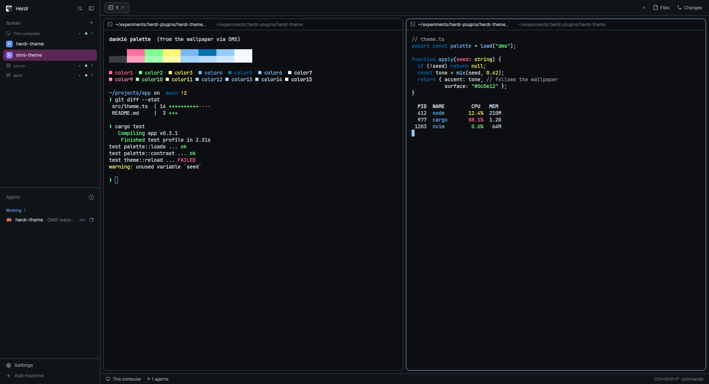

# herdr DMS theme

A herdr-app theme built from DankMaterialShell's wallpaper colors (matugen + dank16).
DMS uses the same colors for its VS Code and Neovim themes.

DMS runs user matugen templates every time it regenerates its theme (when the wallpaper
or light/dark mode changes, for example). These templates write:

| File | Mode |
|---|---|
| `~/.config/herdr-app/themes/dms.json` | follows DMS's current light/dark mode |
| `~/.config/herdr-app/themes/dms-dark.json` | always dark |
| `~/.config/herdr-app/themes/dms-light.json` | always light |

herdr reloads theme files live, so a wallpaper change re-themes herdr right away.



## What's here

- `layouts/dms.json` — Herdr's default layout with the theme set to `dms`. This is what the
  herdr.dev gallery installs.
- `themes/` — a snapshot of the generated themes, so the layout works before DMS has run.
- `templates/` and `install.sh` — the matugen templates that keep the themes in sync with
  your wallpaper.
- `RECIPE.md` — the build brief for agents.
- `preview/` — the scripts used to draw the screenshot.

## Install

```sh
./install.sh
```

The script adds a marked block to `~/.config/matugen/config.toml`. You can run it again
safely, because it replaces its own block. Then change the wallpaper or toggle
light/dark once. Pick **dms** in herdr's theme picker, or run:

```sh
herdr-app do app.theme '{"name":"dms"}'
```

To follow the system appearance, set this in `~/.config/herdr-app/settings.json`:
`"theme": { "light": "dms-light", "dark": "dms-dark" }`.

Requires DMS → Settings → Theme → **Run user matugen templates** (on by default).

## Color mapping

The mapping is the same as DMS's VS Code template.

| herdr | Material / dank16 |
|---|---|
| background (terminals) | `background` |
| canvas, chrome | `surface_container_low` |
| surface / popover, raised / hover | `surface_container` / `_high` / `_highest` |
| selected | `secondary_container` |
| border / input, dim | `outline_variant` / `outline` |
| foreground / muted | `on_surface` / `on_surface_variant` |
| accent, solid, ring, cursor | `primary` (text: `on_primary`) |
| selection | `primary_container` |
| working / blocked / done | `tertiary` / `error` / dank16 green |
| ansi 0–15 | `dank16.color0..15` |

Edit `templates/herdr-dark.json` and regenerate the other two:

```sh
sed 's/\.dark\.hex/.light.hex/g'   templates/herdr-dark.json > templates/herdr-light.json
sed 's/\.dark\.hex/.default.hex/g' templates/herdr-dark.json > templates/herdr.json
```
