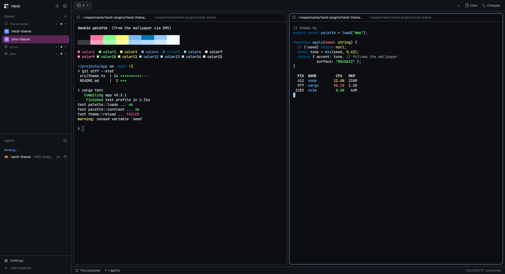

# DMS

This is Herdr's default window, colored from your wallpaper. DankMaterialShell (DMS) uses
matugen to pull a Material You palette and its 16-color `dank16` terminal palette from the
wallpaper. This layout's `dms` theme is built from those same colors, the ones DMS already
puts into VS Code, Neovim, GTK and your terminal. When the wallpaper changes, or you switch
DMS between light and dark, Herdr changes color with it, without a restart.

## What you see

Example values come from a blue night-city wallpaper. Every color comes from the wallpaper,
so yours will differ.

- **Left sidebar** (268px, `chrome` = `surface_container_low`, `#101418`). From top to bottom:
  - the Herdr brand bar (46px)
  - Spaces and Agents, sharing the height equally
  - a 69px footer with Settings and Add machine
  
  Machine headings and section labels use `outline` (`#70767d`). The selected space is a
  rounded `secondary_container` pill (`#5d2755`, the expressive pink-purple) with `on_surface`
  text (`#e0e6ee`).
- **Tab bar** (42px) across the top of the work area, on `canvas` (`#101418`).
- **Panes**: each terminal sits in a card with a 10px radius, 8px gaps and 8px of padding
  around the work area.
  - Background is the wallpaper's `background` (`#0c0e12`).
  - The border is 1px `outline_variant` (`#43484f`).
  - The focused pane's border turns `primary` (`#95ccff`).
  - A 30px pane header sits on top.
- **Terminal text** is `on_surface`. The cursor is `primary`, and selections are
  `primary_container` (`#0472b0`). ANSI 0–15 are DMS's `dank16` (red `#ff729d`, green
  `#7fff90`, yellow `#fff772`, blue `#79b8f2`, …). Your shell, `ls` and git use the same
  colors as kitty or ghostty under DMS.
- **Status bar** (28px) along the bottom. The Files/Changes panel (368px) is hidden until
  you open it.

## How it behaves

- **Agent status**:
  - working = `tertiary` (`#7faffd`)
  - blocked = `error` (`#fa746f`)
  - done = dank16 green (`#7fff90`)
  - idle and unknown = `outline`
- **Hover** = `surface_container_highest`. Popovers and raised controls =
  `surface_container_high`. Accent buttons are `primary` with `on_primary` text (`#00446b`).
- Everything else (keys, clicks, the sidebar, drag, split) works exactly as in Herdr's `main`
  layout. Only the colors change.
- **Light mode**: `themes/dms.json` follows DMS's current mode. Switch DMS to light and the
  file is rewritten with the light Material roles (background `#f8f9fe`, text `#2d333a`,
  light dank16). Herdr picks it up live. `dms-dark` and `dms-light` stay fixed to one mode.

## Built from

- `layouts/dms.json` is a clone of Herdr's `main` layout (`layout.clone {name: main, as: dms}`).
  It has two changes at the root: `"theme": "dms"` and `"preview": "layouts/dms.png"`. The
  node tree:
  - `sidebar` column: `workspace-chrome`, then `spaces` + `agents`, then `workspace-chrome {footer: true}`
  - `work` column:
    - `tabs`
    - `work-body` row: the active tab, plus a hidden `files`/`changes` stack
    - `workspace-status`
  
  It uses only shipped mods. It has no mods of its own and runs no programs.
- `themes/dms.json`, `dms-dark.json` and `dms-light.json` are Herdr themes
  (`background`, `foreground`, `selection`, `cursor`, `ansi[16]`, `colors{}`). The copies in
  this folder are a snapshot from one wallpaper, so the layout works before DMS has run.
- `templates/herdr*.json` are matugen templates that produce those themes. Here is how each
  Herdr color maps to a Material/dank16 role:

  | Herdr color | Material / dank16 role |
  |---|---|
  | `background` | `background` |
  | `canvas`, `chrome` | `surface_container_low` |
  | `surface` | `surface_container` |
  | `popover`, `raised` | `surface_container_high` |
  | `hover` | `surface_container_highest` |
  | `selected` | `secondary_container` |
  | `border` | `outline_variant` |
  | `input`, `dim`, `idle`, `unknown` | `outline` |
  | `foreground` | `on_surface` |
  | `muted` | `on_surface_variant` |
  | `accent`, `solid`, `ring`, `cursor` | `primary` |
  | `accent_foreground`, `solid_foreground` | `on_primary` |
  | `selection` | `primary_container` |
  | `working` | `tertiary` |
  | `blocked` | `error` |
  | `done` | `dank16.color2` |
  | `ansi[i]` | `dank16.color{i}` |

  `herdr-dark.json` uses `.dark.hex`, `herdr-light.json` uses `.light.hex`, and `herdr.json`
  uses `.default.hex` (DMS's current mode).
- `install.sh` adds the three templates to `~/.config/matugen/config.toml` inside a marked
  block, with output in `~/.config/herdr-app/themes/`. DMS merges that file into every
  regeneration when *Run user matugen templates* is on (the default). Herdr hot-reloads
  `themes/*.json`, so no post-hook is needed.

## Watch out

- The `dank16.*` and `colors.*` variables exist only when DMS runs matugen. DMS feeds dank16
  in as `{color0: {dark: {hex}, light: {hex}, default: {hex}}}`. A plain `matugen image`
  fails with "Value does not exist in the context". `~/.cache/dms/dms-colors.json` holds
  plain strings, not `{hex}` objects.
- `dms ipc call theme dark` does nothing when DMS is already dark. To force the first
  generation, change the wallpaper or run `dms ipc call theme toggle` twice.
- Theme files must use plain `#rrggbb`. Herdr doesn't accept the `99` alpha suffix that the
  DMS VS Code template puts on its selection color.
- `dank16.color0` equals `background` in dark mode, so ANSI black text on the default
  background is invisible. The same is true in every DMS terminal theme.
- Cloning `main` freezes its structure at the version cloned (0.1.15) and stops Herdr's
  updates to it. If you only want the colors, skip the layout. Install the themes and pick
  **dms** in the theme menu on any layout.
- Without DMS, the snapshot themes still work, but they stay one fixed palette.

## Done when

- `./install.sh` prints "Added herdr templates". Running it again leaves exactly one
  `herdr-dms-theme` block in `~/.config/matugen/config.toml`.
- After a DMS regeneration, `~/.config/herdr-app/themes/dms.json` exists and is valid JSON
  with no `{{`. Its `background` equals `colors.<mode>.background` in
  `~/.cache/dms/dms-colors.json`, and its `ansi` matches that file's `dank16`.
- `herdr-app do layout.switch '{"name":"dms"}'` shows the window in the wallpaper's colors:
  - the sidebar is `surface_container_low`
  - the focused pane border is `primary`
  - terminal ANSI colors match ghostty/kitty under DMS
- Changing the DMS wallpaper re-colors the open Herdr window within a few seconds, with no
  restart.
